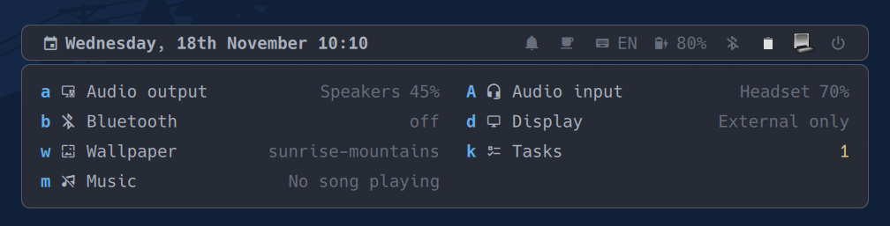
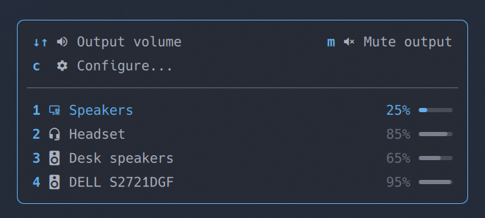

# quick-key

[](https://nixos.org/)
[](https://bphenriques.github.io/quick-key)
[](#)
[](LICENSE)

A keyboard-driven [Quickshell](https://quickshell.org) menu with live status, in the style of [`wlr-which-key`](https://github.com/MaxVerevkin/wlr-which-key), plus pop-ups for volume, brightness, keyboard layout and keep-awake. Works out of the box; configured from a home-manager module or a `config.json`.

It is a menu first: it sits beside the bar or shell you have and replaces neither. The rest is plugins, off until listed: most are a command and a few lines of config ([recipes](https://bphenriques.github.io/quick-key/recipes.html)), and the shipped ones (a panel to ask an agent, a notification server in place of dunst or mako, pills for recording and dictation, a niri minimap) show how far one can go.

| Menu | Audio output |
|---|---|
|  |  |
| **Calendar** | **Ask** |
|  |  |

Example:
```nix
{ inputs, ... }:
{
  imports = [ inputs.quick-key.homeModules.default ];

  programs.quick-key = {
    enable = true;
    calendarSync.enable = true;
    settings = {
      theme.name = "catppuccin-mocha";
      plugins.niriMinimap = { };   # niri workspace minimap
    };
  };
}
```

Bind `"${config.programs.quick-key.exec.ipc} menu toggle"` to a compositor key to open it. Without Nix, it is a plain Quickshell config with an optional `config.json`. More in the [docs](https://bphenriques.github.io/quick-key).

I built it for my own [desktop](https://github.com/bphenriques/dotfiles). It is open by design and if this project intrigues and interests you let me know!

> [!WARNING]
> **Work in progress.** Linux and niri only for now, and the option surface still moves.

## Support

I don't expect anything back but if it saved you time and you feel like it, [buy me a coffee](https://buymeacoffee.com/bphenriques) ☕

## AI Disclaimer

I drive the architecture, the design, and the scope. AI has been invaluable to learn and iterate faster.

## License

MIT
