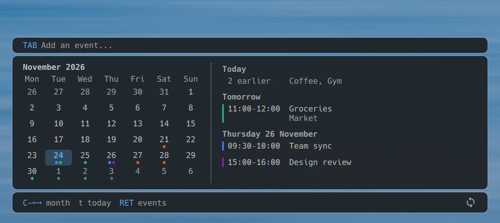
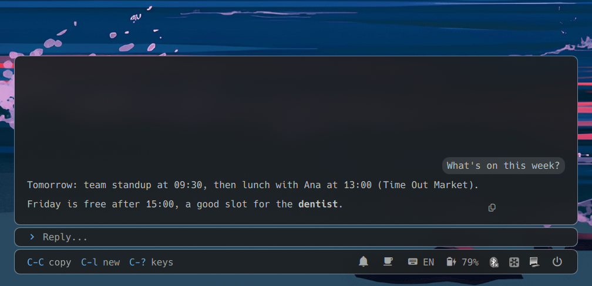

# quick-key

[](https://nixos.org/)
[](https://bphenriques.github.io/quick-key)
[](#)
[](LICENSE)

A keyboard-driven [Quickshell](https://quickshell.org) menu in the style of [`wlr-which-key`](https://github.com/MaxVerevkin/wlr-which-key), whose rows show live state beside labels that never change, and where the key path you press (`a 2`) is the binding you script. Pop-ups show volume, the microphone, brightness, keyboard layout and keep-awake as they change. Works out of the box; configured from a home-manager module or a `config.json`.

It is a menu first: it sits beside the bar or shell you have and replaces neither. The rest is plugins, off until listed. Most are a command and a few lines of config ([recipes](https://bphenriques.github.io/quick-key/recipes.html)); the shipped ones add a panel to ask an agent, pills for recording and dictation, and a niri minimap.

| Menu | Audio output |
|---|---|
|  |  |
| **Calendar** | **Ask** |
|  |  |

Example:
```nix
{ inputs, ... }:
{
  imports = [ inputs.quick-key.homeModules.default ];

  programs.quick-key = {
    enable = true;
    settings = {
      theme.name = "catppuccin-mocha";
      plugins.niriMinimap = { };   # niri workspace minimap
    };
  };
}
```

Bind a compositor key to open it; in niri, `Mod+Space { spawn-sh "${config.programs.quick-key.exec.ipc} menu toggle"; }`. Without Nix, it is a plain Quickshell config with an optional `config.json`. More in the [docs](https://bphenriques.github.io/quick-key).

I built it for my own [desktop](https://github.com/bphenriques/dotfiles). It is open by design: if it interests you, let me know!

> [!WARNING]
> **For personal use, for now.** Linux only, and settings may change between releases. Built and tested on niri; on another Wayland compositor all but the keyboard layout and output details work (see [Compositor](https://bphenriques.github.io/quick-key/compositor.html)).

## Scope

Releases stay 0.x: nothing is promised stable. A release's notes list what breaks, and a setting that is renamed or removed fails the check, saying what to write instead.

- **In:** the menu (levels, keys, key paths, filtering, the bar, inputs); what every desktop has (audio and apps' volume, the microphone, network, Bluetooth, power and battery, backlight and outputs, the tray, music, the keyboard layout, keep awake); the pop-up for changes; the calendar read from a file any tool can write; command and QML plugins; the check as the configuration builds.
- **Shipped plugins:** tasks; ask, quick turns with an ACP agent (longer work moves to a terminal); recording, dictation, dunst, mako and a niri minimap. `calendar-sync` (experimental) is one writer of the calendar and tasks files.
- **Out:** a launcher, a permanent bar, a settings app; backends for compositors other than niri (the rest works without one); finding Wi-Fi networks or pairing Bluetooth devices; an agent client that does a terminal agent's job; reading a tool's own output format.

## Support

I don't expect anything back but if it saved you time and you feel like it, [buy me a coffee](https://buymeacoffee.com/bphenriques) ☕

## AI Disclaimer

I drive the architecture, the design, and the scope. AI has been invaluable to learn and iterate faster.

## License

MIT
