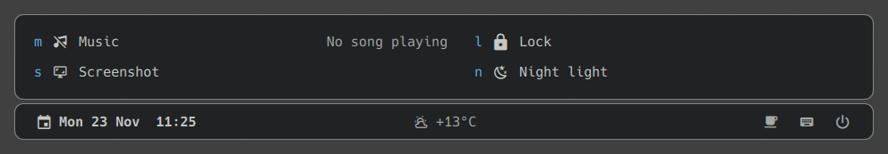
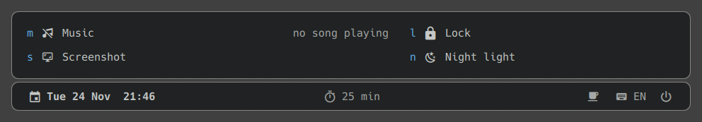
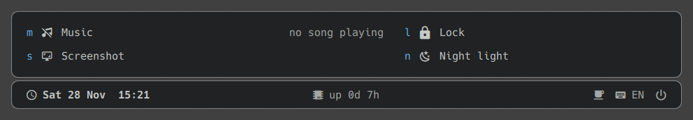
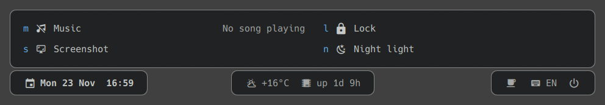
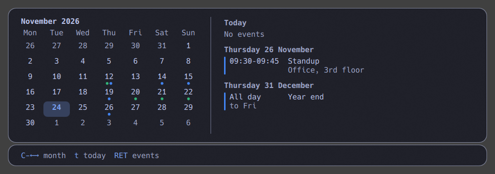

# Recipes

Short configs for the common shapes, each to adapt. They are written for `programs.quick-key.settings`; a plain `config.json` takes the same keys. `<glyph>` stands for a Nerd Font glyph.

## Extend the starter

Each recipe adds to the starter menu. Setting `menu.entries` replaces the starter whole, so begin from its entries, read from the flake's source:

```nix
{ inputs, lib, ... }:
{
  programs.quick-key.settings.menu.entries =
    (lib.importJSON "${inputs.quick-key}/packages/quick-key/menu.json").menu.entries;
}
```

A recipe's entries then join them from any module, in the order `lib.mkOrder` gives. Without Nix, copy [`menu.json`](https://github.com/bphenriques/quick-key/blob/main/packages/quick-key/menu.json) to `config.json` and add each recipe's entries to its `menu.entries`.

## The menu

### Run a command

```nix
menu.entries = [
  { key = "l"; desc = "Lock"; icon = "<glyph>"; cmd = "loginctl lock-session"; }
];
```

The menu closes as it runs; `keepOpen = true` keeps it open, for a command you repeat.

### A level of commands

```nix
{ key = "s"; desc = "Screenshot"; icon = "<glyph>"; submenu = [
  { key = "s"; desc = "Screen"; icon = "<glyph>"; cmd = "grim"; }
  { key = "r"; desc = "Region..."; icon = "<glyph>"; cmd = ''grim -g "$(slurp)"''; }
  { key = [ "Left" "Right" ]; desc = "Wallpaper"; icon = "<glyph>"; cmd = [ "wallpaper previous" "wallpaper next" ]; keepOpen = true; }
]; }
```

Two keys with a command each share a row.

### Open an entry from a compositor key

```kdl
// niri
Mod+P { spawn "qs" "-c" "quick-key" "ipc" "call" "menu" "toggleEntry" "d"; }
```

`d` is the entry's key. With Nix, `"${config.programs.quick-key.exec.ipc} menu toggleEntry d"`.

### Keep a device on its digit

```nix
{ key = "a"; desc = "Audio output"; status = "sink"; list = "sinks";
  pins = [
    { match = "alsa_output.pci-*"; label = "Speakers"; }
    { match = "bluez_output.*"; label = "Headphones"; }
  ];
  submenu = [ { key = [ "Down" "Up" ]; desc = "Volume"; action = "sinkVolume"; } ];
}
```

Pins take the digits from 1, dimmed while absent, so `a 2` is always the headphones.

### Clipboard history

```nix
plugins.clipboard = {
  type = "command";
  read = ''cliphist list | head -n 50 | jq -Rsc '{items: (split("\n") | map(select(length > 0) | {id: ., label: (split("\t") | .[1:] | join(" "))}))}' '';
  # The item comes last, as $1: a function puts it where the pipe needs it.
  select = ''paste() { printf %s "$1" | cliphist decode | wl-copy; }; paste'';
};
menu.entries = [
  { key = "v"; desc = "Clipboard"; icon = "<glyph>"; list = "clipboard"; }
];
```

`/` filters the list as you type; `cliphist` and `wl-clipboard` go in `extraPackages`.

## Status and toggles

### A value beside a label

```nix
plugins.load = {
  type = "command";
  read = ''printf '{"detail": "%s"}' "$(cut -d' ' -f1 /proc/loadavg)"'';
  every = 2;   # seconds, only while the menu is open
};
menu.entries = [
  { key = "p"; desc = "Processes..."; status = "load"; cmd = "foot btop"; }
];
```

`detail` sits on the right of the label. A plain line (`0.42`) would take the label's place instead.

### A toggle that lights

```nix
plugins.nightLight = {
  type = "command";
  read = "systemctl --user is-active wlsunset";
  show.active.active = true;
};
menu.entries = [
  { key = "n"; desc = "Night light"; icon = "<glyph>"; activeWhen = "nightLight"; keepOpen = true;
    cmd = "systemctl --user is-active -q wlsunset && systemctl --user stop wlsunset || systemctl --user start wlsunset; qs -c quick-key ipc call nightLight refresh"; }
];
```

A `read` source is read as the menu opens, so the command asks for another read once it is done. A tool with events needs none: give it as `watch`.

### Pick one of a few

```nix
plugins.displays = {
  type = "command";
  read = "display-layout get";     # prints the id in use
  select = "display-layout set";   # given the item's id
  items = [
    { id = "laptop"; label = "Laptop only"; icon = "<glyph>"; }
    { id = "external"; label = "External only"; icon = "<glyph>"; }
    { id = "extend"; label = "Extend"; icon = "<glyph>"; }
  ];
};
menu.entries = [
  { key = "d"; desc = "Display"; status = "displays"; list = "displays"; }
];
```

The items take the digits; the one the source names is lit, and is what the entry shows.

### Items that come and go

```nix
plugins.containers = {
  type = "command";
  read = ''podman ps --format json | jq -c '{items: map({id: .Names[0], label: .Names[0], detail: .Status})}' '';
  select = "podman restart";
};
menu.entries = [
  { key = "c"; desc = "Containers"; icon = "<glyph>"; list = "containers"; }
];
```

The state line carries the items when the settings list none.

### State a script writes

```nix
plugins.backup = {
  type = "command";
  file = "backup";   # under $XDG_RUNTIME_DIR
  show.running = { text = "Backing up"; phase = "working"; };
  show.failed = { text = "Backup failed"; phase = "error"; };
};
```

The script writes `running` to the file as it starts, then empties it, or writes `failed`; the shell reads it on every change, with nothing running in between. `phase` is how every surface draws work: `working` spins, `error` alerts ([The state line](plugins.md#the-state-line)).

### A VPN

```nix
plugins.vpn = {
  type = "command";
  read = ''tailscale status --json | jq -r 'if .BackendState == "Running" then "up" else "down" end' '';
  show.up = { glyph = "<glyph>"; text = "connected"; active = true; };
  show.down = { glyph = "<glyph>"; text = "off"; };
  activate = ''tailscale status --json | jq -e '.BackendState == "Running"' > /dev/null && tailscale down || tailscale up; qs -c quick-key ipc call vpn refresh'';
};
menu.header.right = [ "vpn" ];
```

A click on it in the bar toggles it; for a key, make it an entry (`{ key = "v"; desc = "VPN"; status = "vpn"; activeWhen = "vpn"; cmd = "..."; }`). A NetworkManager or WireGuard connection is the same shape: `read` from `nmcli -g GENERAL.STATE connection show wg0`, toggle with `nmcli connection up` and `down`.

### The weather

```nix
plugins.weather = {
  type = "command";
  # wttr.in's symbol for the sky, then the temperature: {"value": "m", "text": "+13°C"}
  read = ''curl -sf 'https://wttr.in/Lisbon?format=%x+%t' | jq -Rc 'split(" ") | {value: .[0], text: .[1]}' '';
  every = 900;
  glyph = "<cloud>";
  show = { "o".glyph = "<sun>"; "m".glyph = "<sun behind cloud>"; "/".glyph = "<rain>"; "//".glyph = "<showers>"; "*".glyph = "<snow>"; };
};
menu.header.center = [ "weather" ];
```



Read as the menu opens and every 15 minutes while it stays open. `show` picks the glyph by the sky, and its other [symbols](https://github.com/chubin/wttr.in/blob/master/internal/renderer/oneline/constants.go) take `glyph`; with no network, `glyph` shows alone until the next read. Leave the place out (`wttr.in/?format=...`) for wttr.in to guess it from your address.

### An external monitor's brightness

```nix
plugins.monitor = {
  type = "command";
  read = ''ddcutil getvcp 10 --brief | awk '{ printf "{\"text\": \"%s%%\"}\n", $4 }' '';
};
menu.entries = [
  { key = [ "Down" "Up" ]; desc = "Monitor brightness"; icon = "<glyph>"; status = "monitor"; keepOpen = true;
    cmd = [ "ddcutil setvcp 10 - 10" "ddcutil setvcp 10 + 10" ]; }
];
```

DDC is slow, a second or so a step, and the level is read again as the menu opens.

### A focus timer

```nix
plugins.focus = {
  type = "command";
  file = "focus";
  glyph = "<glyph>";
  activate = ''for m in $(seq 25 -1 1); do echo "$m min" > "$XDG_RUNTIME_DIR/focus"; sleep 60; done; : > "$XDG_RUNTIME_DIR/focus"; notify-send "Focus is over"'';
};
menu.header.center = [ { key = "f"; desc = "Focus"; status = "focus"; } ];
```



`C-f`, or a click, starts 25 minutes. The bar counts them down from the file, and shows the glyph alone once the loop empties it.

## The bar

### In the bar

```nix
plugins.dunst = { };
menu.header.right = [ "dunst" "battery" ];
```

A plugin in a bar shows its glyph, lit while active; a click calls its `activate`. Any `command` plugin works the same. For a key, make it an entry: `{ key = "d"; desc = "Do not disturb"; status = "dunst"; cmd = "dunstctl set-paused toggle"; }` runs on `C-d`.

### Text of your own in the bar

```nix
plugins.uptime = {
  type = "command";
  read = ''awk '{ printf "up %dd %dh\n", $1 / 86400, $1 % 86400 / 3600 }' /proc/uptime'';
  every = 60;
  glyph = "<glyph>";
};
menu.header.center = [ "uptime" ];
```



The last line a command prints is the text beside the glyph. For text a script writes, give `file` instead ([State a script writes](#state-a-script-writes)).

### A bar on top, as islands

```nix
menu.edge = "top";
menu.islands = true;
menu.margin = 10;
popups.position = "top";
```



The bar sits on top, each slot on an island of its own, and pop-ups show there too. It is still the menu: it shows on a key and hides on `ESC`, so it does not replace a bar that is always there. Keep waybar for that, with `theme.besideBars = true` so the menu keeps clear of it. A bar down a side of the screen, or one that sizes itself to what it shows, is not on offer: a level keeps a top or bottom edge and its width.

## The look

### Colours from the wallpaper

A tool that writes a theme file is a theme: matugen's template is the shipped theme's keys filled from its palette.

```json
{ "background": "{{colors.surface.default.hex}}", "foreground": "{{colors.on_surface.default.hex}}", "primary": "{{colors.primary.default.hex}}",
  "alert": "{{colors.error.default.hex}}", "warning": "{{colors.tertiary.default.hex}}", "border": "{{colors.outline_variant.default.hex}}" }
```

matugen writes it to `$XDG_CONFIG_HOME/quick-key/themes/matugen.json`, `theme.name = "matugen"` picks it, and its colours apply as the file changes, nothing reloading. With Nix, which owns that folder, matugen writes elsewhere and the theme links to it, so the build knows it: `xdg.configFile."quick-key/themes/matugen.json".source = config.lib.file.mkOutOfStoreSymlink "${config.xdg.cacheHome}/matugen/quick-key.json";`. pywal works the same way, its template using `{background}`, `{foreground}` and `{color1}` to `{color8}`.

### A look of your own

```nix
theme = {
  name = "tokyo-night";
  radius = 16;
  itemRadius = 8;
  surfaceOpacity = 0.85;
  padding = 18;
};
```



Each size and opacity is a setting, bounded by the check; the [reference](options.md) lists them.
